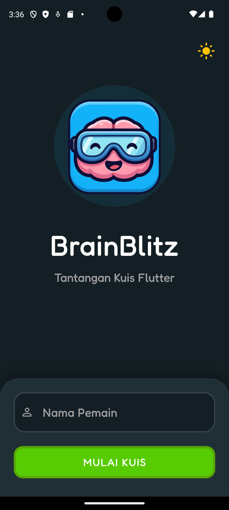
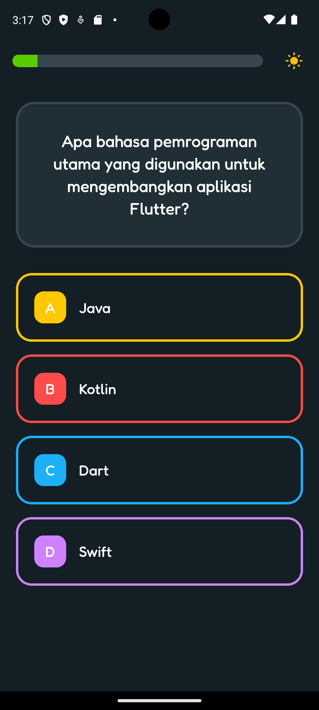
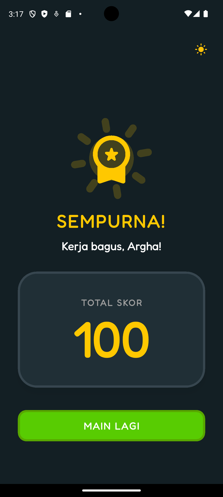

# 🚀 BrainBlitz - Gamified Flutter Quiz App

BrainBlitz adalah aplikasi kuis interaktif berbasis *mobile* dengan antarmuka bergaya *gamified* yang ceria dan modern. Aplikasi ini dirancang untuk menguji pengetahuan dasar tentang framework Flutter dengan pengalaman UI/UX yang dinamis.

## 👨‍💻 Identitas Mahasiswa
- **Nama:** Argha Niqie Wijaksono
- **NIM:** [241401096]
- **Mata Kuliah:** Praktikum Pemrograman Mobile
- **Kelas/Lab:** [PM 6]

---

## ✨ Fitur Utama
1. **Gamified UI & Animations:** Menggunakan tata letak bergaya permainan kasual dengan elemen UI yang interaktif.
2. **Global Dual-Theme:** Mendukung tema terang (*Light Mode*) dan gelap (*Dark Mode*) dengan palet warna khusus yang bisa diubah kapan saja.
3. **Dynamic Randomized Colors:** Warna tombol pilihan ganda diacak secara murni (*shuffled*) di setiap pertanyaan agar tampilan tidak membosankan.
4. **State Management (Provider):** Menyimpan identitas pemain, progres pertanyaan, dan skor secara persisten (aman saat layar dirotasi).
5. **Navigasi Aman (GoRouter & PopScope):** Transisi antar layar berjalan mulus, dilengkapi dialog pencegahan (*alert*) jika pengguna menekan tombol *back* secara tidak sengaja di tengah kuis.

---

## 🛠️ Teknologi & Aset yang Digunakan
- **Framework:** Flutter & Dart
- **State Management:** Provider
- **Routing:** GoRouter
- **Tipografi:** Google Fonts (Fredoka)
- **Ikonografi:** Material Design Icons

---

## 📸 Tangkapan Layar Aplikasi

| Welcome Screen | Quiz Screen | Result Screen |
| :---: | :---: | :---: |
|  |  |  |

---
*Proyek ini dikembangkan sebagai pemenuhan tugas Ujian Tengah Semester (UTS).*